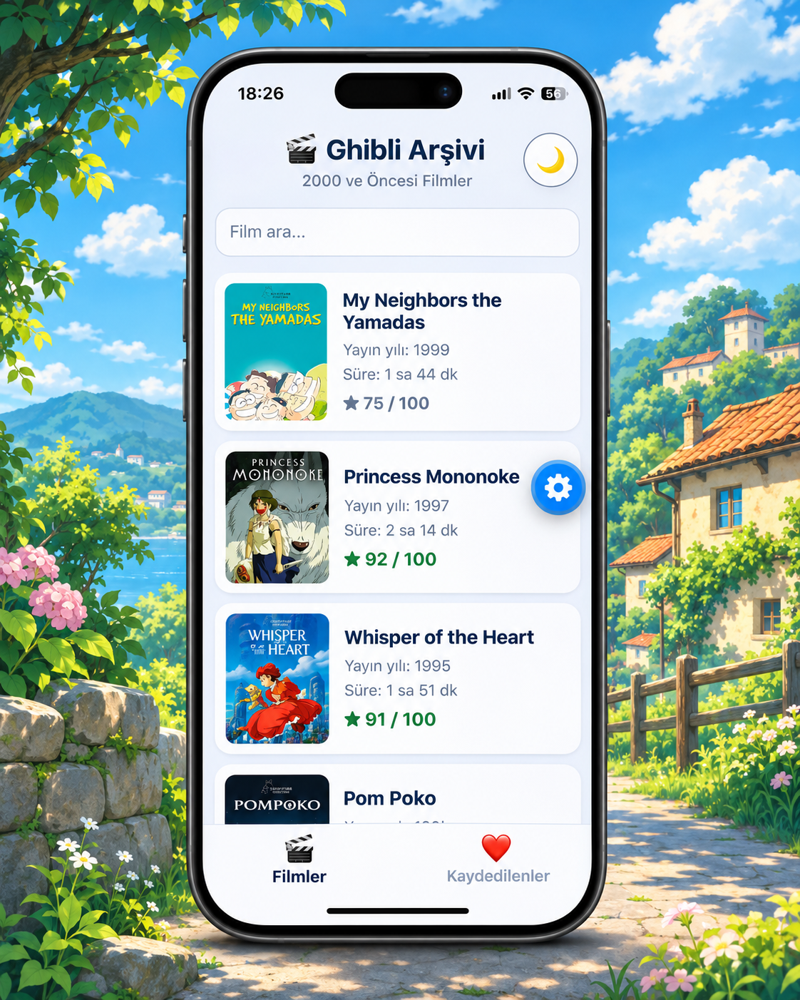

# 🎬 Ghibli Arşivi

BSM447 Mobil Uygulama Geliştirme - Dönem Projesi

## Öğrenci Bilgileri

- Ad Soyad: Muaz Swis
- Öğrenci Numarası: B231210577
- Konu: K23 - Ghibli Arşivi
- Varyant: a - 2000 ve öncesinde yayımlanan filmler
- Ek Kural: 7 - Kalıcı Karanlık/Aydınlık Tema

## Proje Hakkında

Ghibli Arşivi, React Native ve Expo kullanılarak geliştirilen mobil film arşivi uygulamasıdır.

Studio Ghibli API üzerinden filmler alınır ve 2000 yılı ve öncesinde yayımlananlar listelenir.

## Uygulama Özellikleri

- API üzerinden film verilerini çekme
- 2000 ve öncesi filmleri filtreleme
- Film adına göre arama
- Film posterlerini ve yayın yıllarını gösterme
- Film detay ekranı
- Yönetmen, süre, puan ve açıklama bilgileri
- Süreyi saat ve dakika biçiminde gösterme
- 90 ve üzeri puanlarda yeşil etiket
- Favorilere ekleme ve çıkarma
- Kaydedilenler ekranı
- AsyncStorage ile kalıcı favoriler
- Karanlık ve aydınlık tema
- Tema tercihini AsyncStorage ile saklama

## Kullanılan Teknolojiler

- React Native
- Expo SDK 58
- JavaScript
- React Navigation (Stack ve Bottom Tabs)
- AsyncStorage
- Fetch API
- FlatList

## API

https://ghibliapi.vercel.app/films

## Ekran Görüntüleri

### Film Listesi

### Film Detayı

### Kaydedilenler

## Kurulum

Bağımlılıkları yüklemek için:

    npm install

Uygulamayı başlatmak için:

    npx expo start

## Android APK

Uygulama Expo EAS Build kullanılarak derlenmiştir.

- Sürüm: 1.0.0
- Build profili: preview
- Platform: Android
- Test: Android telefona kuruldu ve çalıştırıldı

[Android APK dosyasını indir](https://github.com/Muazswis/bsm447-odev-B231210577/releases/download/v1.0.0/B231210577_Ghibli_Arsivi.apk)

## Tanıtım Videosu

Film listesi, film detayı, favoriler ve tema değiştirme işlemlerini gösteren 60 saniyeden kısa ekran kaydıdır.

[Tanıtım videosunu indir](https://github.com/Muazswis/bsm447-odev-B231210577/releases/download/v1.0.0/B231210577_Tanitim.mp4)

## GitHub Release

[Uygulamanın v1.0.0 sürümü](https://github.com/Muazswis/bsm447-odev-B231210577/releases/tag/v1.0.0)

## GitHub Deposu

https://github.com/Muazswis/bsm447-odev-B231210577

## Geliştirici

Muaz Swis - B231210577
